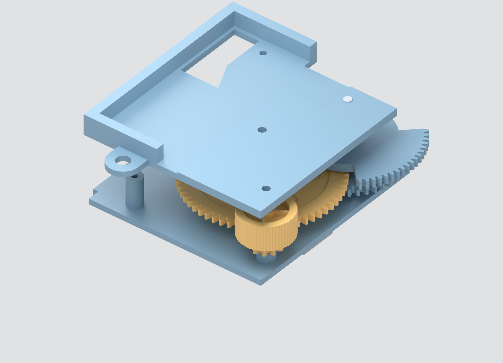
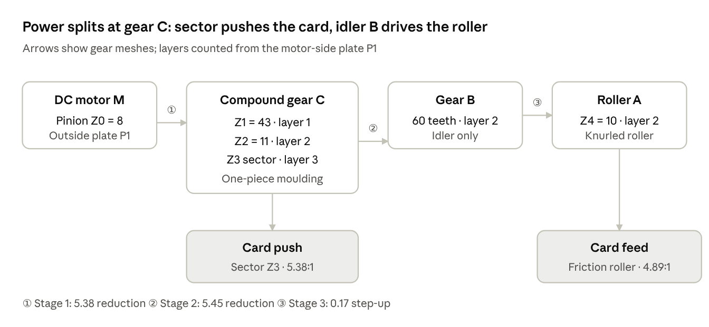
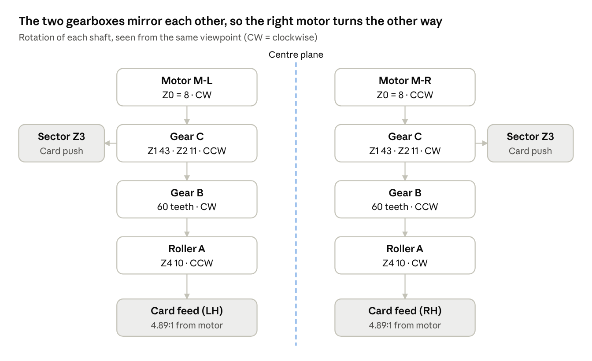
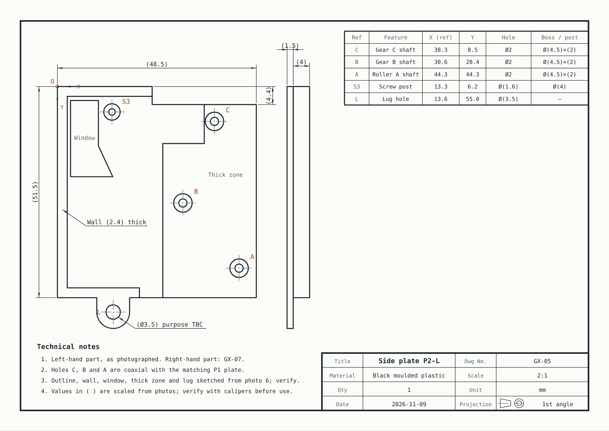
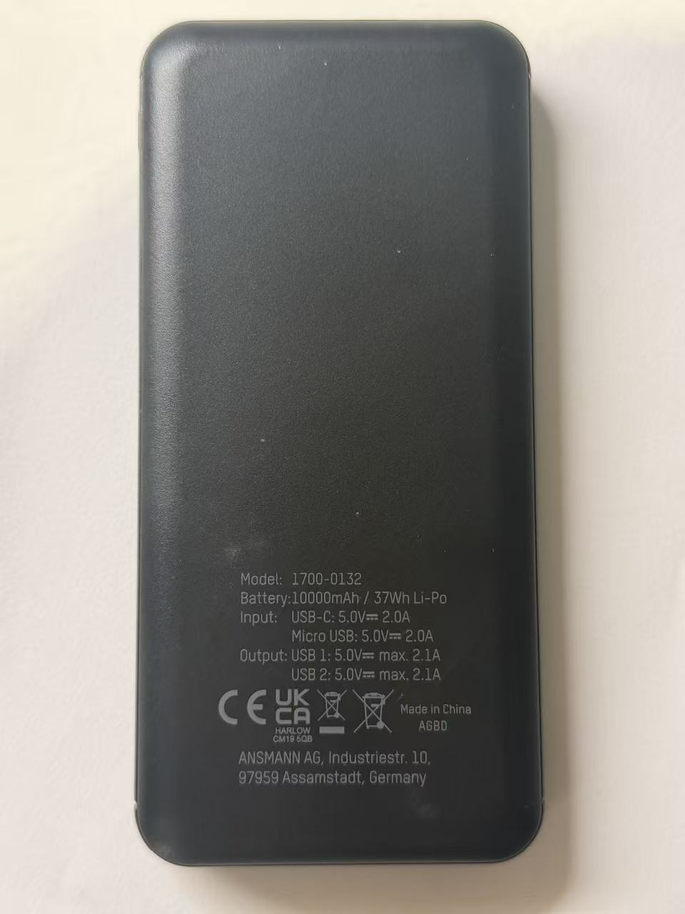
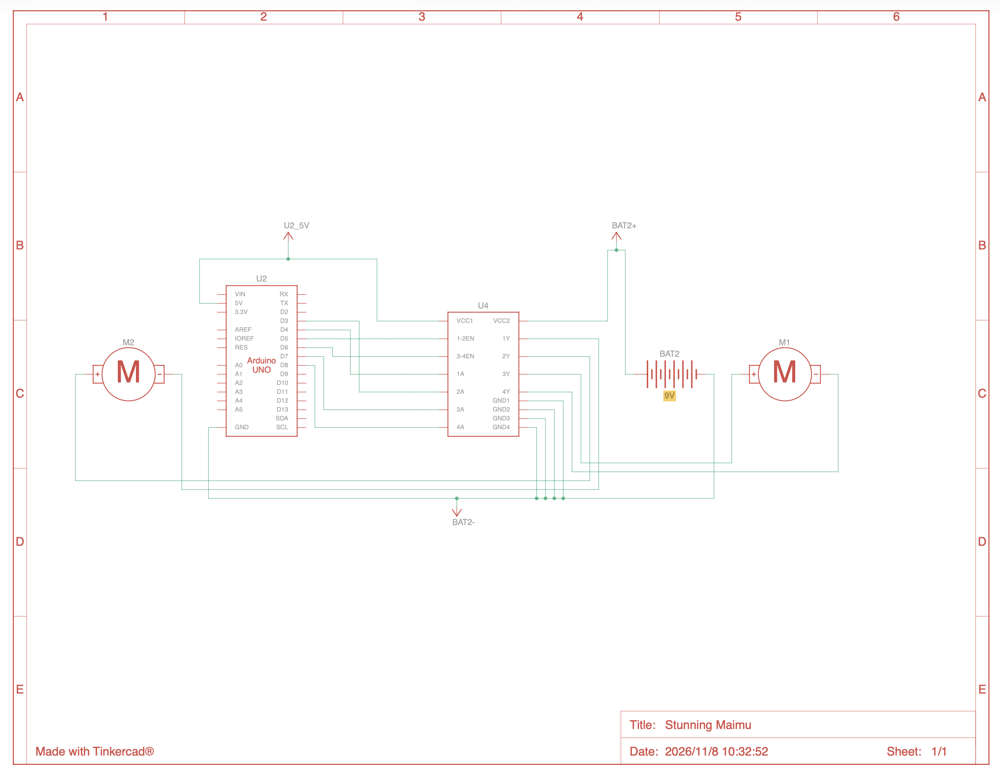
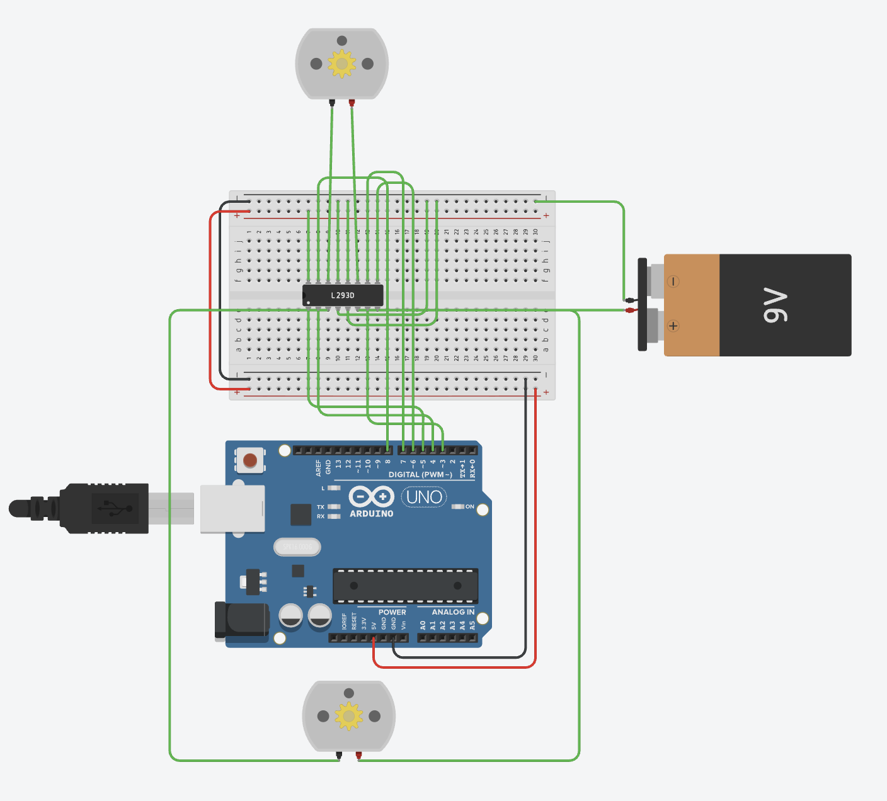
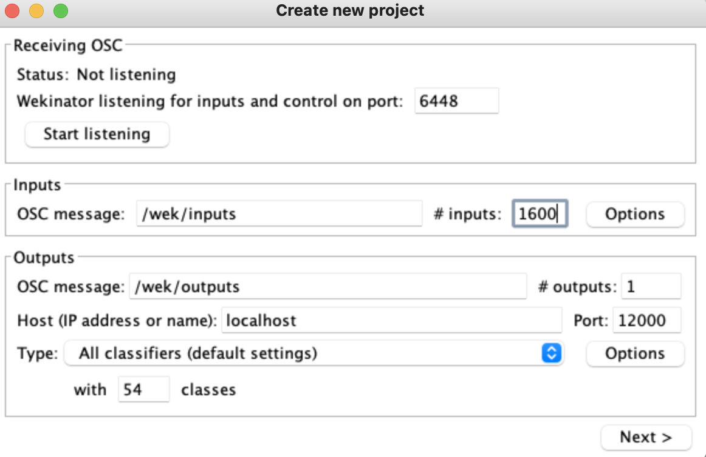
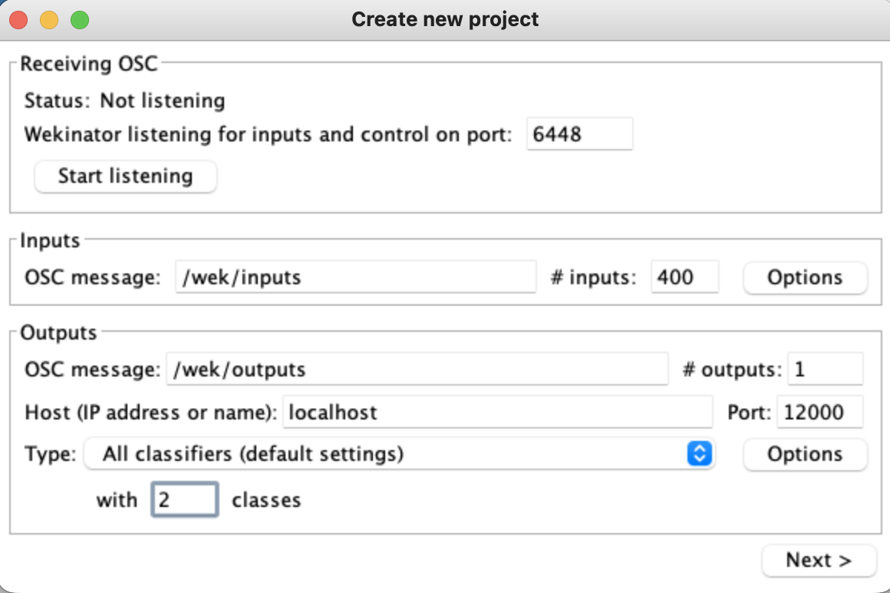
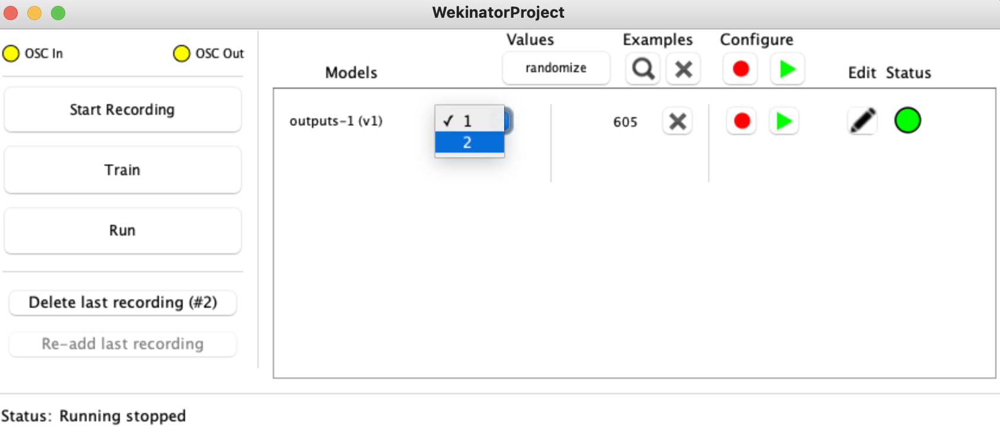

# Card Magic An Interactive Machine Learning Card Machine

## Files and navigation

- [Final Arduino source](arduino/TwoDC/TwoDC.ino)
- [Final Processing source](processing/ExternalCamera_Control_v2/ExternalCamera_Control_v2.pde)
- [Wekinator project](wekinator/WekinatorProject/WekinatorProject.wekproj)
- [Runtime quick guide](docs/final-runtime.md)
- [Download Word report and complete runtime package](docs/downloads/CardMagic_Final_Delivery.zip)
- [Mechanical design](#2-mechanical-design)
- [Hardware design](#3-hardware-design)
- [Software design](#4-software-design)
- [Machine learning](#5-machine-learning-design-and-training)
- [Debugging and iteration](#6-debugging-and-iteration)
- [Limitations](#7-limitations)
- [Installation and operation](#8-software-installation-and-operation)

## 1 Project Overview

Card Magic is an interactive card magic installation combining mechanical feeding, computer vision and machine learning. Two DC motors provide shuffling and intermittent card feeding. A camera captures images, and Wekinator detects an all-black marker card. The machine locates the user’s selected card through its adjacency to the marker card.

The project does not attempt to recognise all 52 playing cards. After detecting the marker, the system performs additional feeding to deliver the selected card and displays “this is your card” on the computer.

| Key | Mode | Action |
| --- | --- | --- |
| S | Shuffle | Both motors run continuously, feeding both stacks towards the centre |
| D | Recognition | Only the left motor feeds intermittently; the camera and Wekinator perform recognition |
| X | Stop | Stop both motors and end the current run |

### 1.1 Design Objectives and User Experience

The objectives are to make a conventional shuffling mechanism computer-controlled; combine continuous shuffling and intermittent recognition in one system; support the trick through binary classification rather than full card identification; connect machine learning results to actuators in real time; and establish a repeatable selection, cutting and reveal sequence.

The interaction consists of shuffling, selection and revelation. The user watches the machine shuffle, selects a card, returns it and cuts the deck, then watches the machine locate it. Machine learning detects only the marker, not the identity of the selected card. This division reduces training work and hides the technical process within a simple magic interaction.

Ordinary cards share similar backgrounds, layouts and suit features; the all-black card has a more distinct overall brightness. The final model assigns ordinary cards to class 1 and the all-black marker to class 2. Class 1 maintains feeding. Class 2 latches the detection event, after which the machine completes its final feeding sequence and stops.

### 1.2 Complete User Journey

1. Divide the deck into two stacks and place them in the left and right hoppers.

2. Press S to shuffle. When finished, press X, remove the cards and square the deck.

3. Arrange the order so that the all-black marker will be at the bottom of the remaining deck after card selection.

4. Deal cards and let the user call stop at their chosen point to select a card.

5. Ask the user to place the selected card at the bottom of the remaining deck, adjacent to the marker.

6. Ask the user to “cut the deck”.

7. Place the entire deck in the left hopper, check the camera image and press D.

8. The left motor feeds intermittently while the camera continuously captures images.

9. Wekinator outputs class 2, and the system records the marker event.

10. Beginning with the next complete feeding pulse, execute three additional pulses, then stop.

11. Arduino returns TARGET_DONE, and the computer displays “this is your card”.

The method depends on adjacency and the actual feeding direction. After selection, the user cuts the deck rather than interleaving the cards in another shuffle.

### 1.3 Materials Fabrication and Aesthetic Expression

Card Magic combines the familiar form of a card shuffler with hidden visual recognition. Symmetrical loading areas and a central collection space make it clear where cards enter and are retrieved. Behind this familiar operation, the camera, classification software and motor control produce the effect of finding the user’s card. The appearance and structure present a complex technical process as a clear, coherent magic experience.

A compact gear train transfers motor motion to the feeding mechanism. Repeated structures on the two sides create visual order and reflect their shared role during shuffling. Recognition uses the same loading and transport structure, avoiding an additional mechanical operation for the user to learn.

The enclosure does more than cover the mechanism: it organises visual information by separating circuitry and wiring from the user’s operating area. Attention is directed towards card entry, movement and the final reveal. Concealing the internal control process also strengthens the impression that the machine somehow knows the user’s selection.

Fabrication combines mechanical assembly, enclosure construction and programmable control. The structure and controls are tested separately before integration, allowing feeding rhythm to support camera recognition and revelation. Continuous movement during shuffling contrasts with intermittent feeding during recognition, distinguishing the functions and creating a progression from preparation through anticipation to the reveal.

The aesthetic expression therefore comes not only from static appearance, but also from spatial arrangement, the concealment of technology, and the coordination of movement with on-screen feedback. Materials and fabrication serve the central concept: turning machine learning and physical control into a participatory card magic experience that creates surprise.

## 2 Mechanical Design

### 2.1 Overall Structure and Modifications

The final prototype uses two DC motors, each driving a separate gear module. The left hopper holds part of the deck during shuffling and the full deck during recognition; the right hopper is used for shuffling. Rollers and pushing components move cards towards the central drop area. The camera observes the recognition area, while the enclosure houses the mechanism and circuitry.

Modifications include programmable motor control, continuous and intermittent operation, computer communication, camera and machine learning integration, and a rebuilt enclosure. The focus is to incorporate the feeding action into a software-coordinated interaction.

### 2.2 Single Side Gearbox and Components

The two gearboxes are mirrored about the machine’s centre plane. Each is driven by one DC motor, with gears supported by three steel shafts between two plastic side plates. The complete machine contains two motors, six main gear components, six steel shafts and four side plates.

| ID | Component | Structure and function | Total quantity |
| --- | --- | --- | --- |
| M / Z0 | Motor and pinion | 8-tooth motor pinion enters the gearbox through a side-plate opening | 2 |
| C | Compound gear | 43-tooth Z1 and 11-tooth Z2 integrated with the sector pusher | 2 |
| B | Idler gear | 60 teeth; connects the compound gear to the feed-roller pinion | 2 |
| A / Z4 | Feed roller | 10-tooth pinion connected to a straight-knurled roller body for friction feeding | 2 |
| S | Steel shaft | 2 mm diameter; both ends supported in side-plate holes | 6 |
| P1-L / P1-R | Motor side plates | Motor mounting, location of three shafts and fixing posts | 1 each |
| P2-L / P2-R | Outer side plates | Support and enclose each module with its motor side plate | 1 each |

Figures M1 and M2 were generated from the supplied single-side STL models and show the internal gear layout and complete assembly. The model includes feed roller A, idler gear B, compound gear C, two support plates, steel shafts and a motor envelope reference.

Figure M1 Single-side gear module with the outer plate removed to show the internal transmission.

Figure M2 Complete single-side gear module. Colours distinguish components; the motor is an envelope reference.

### 2.3 Power Path and Three Layer Layout

Motor pinion Z0 drives Z1 on compound gear C. At C, power follows two paths: one rotates the coaxial sector-shaped pusher; the other drives feed roller A through Z2, idler gear B and Z4.

Power path: motor Z0 → Z1 on C; Z2 on C → B → Z4 on A. The sector pusher rotates with C.

Figure M3 Power branching diagram from the supplementary mechanical report.

| Axial layer | Components | Function |
| --- | --- | --- |
| Layer 1 near P1 | Z0 and Z1 | Motor input and first reduction stage |
| Layer 2 | Z2, B and Z4 | Transfer motion to the feed roller |
| Layer 3 | Sector pusher and roller body | Push and friction-feed cards |

Z1, Z2, the hub and the sector pusher form one integral component C, with no relative rotation between them. The supplementary report labels the sector Z3 and records 18 fine teeth along its 90° arc. This arc does not mesh with another gear; it projects beyond the housing during rotation to help push cards. The rim of feed roller A extends beyond the side plate outline and contacts cards through its knurled surface.

### 2.4 Reduction Ratios and Rotation Directions

The following tooth counts and dimensions are recorded in the supplementary report. The overall reduction ratio to the feed roller is:

iA = (43 ÷ 8) × (60 ÷ 11) × (10 ÷ 60) = 4.89

The tooth count of idler B cancels from the overall ratio. Its main functions are to transfer motion, bridge the shaft spacing and change rotation direction. The sector rotates with Z1, giving a reduction ratio of:

iC = 43 ÷ 8 = 5.38

| Stage | Driver and driven gear | Teeth | Reduction ratio |
| --- | --- | --- | --- |
| 1 | Z0 → Z1 | 8 → 43 | 5.38 |
| 2 | Z2 → B | 11 → 60 | 5.45 |
| 3 | B → Z4 | 60 → 10 | 0.17 speed-increasing stage |
| Motor to feed roller | Three stages combined | — | 4.89 |
| Motor to sector | Coaxial with Z1 | — | 5.38 |

Viewed from the motor side, clockwise motor rotation produces anticlockwise rotation of the compound gear and sector, clockwise rotation of idler B, and anticlockwise rotation of feed roller A. The roller and sector therefore rotate in the same direction.

The report derives a module of 0.6 from the outside diameters and tooth counts. Z1 has 43 teeth and a 27 mm outside diameter, giving m = 27 ÷ (43 + 2) = 0.6. The recorded outside diameter of Z4 is 8 mm, greater than the standard 7.2 mm for a 10-tooth, module 0.6 gear. The report suggests positive profile shift as an explanation; the tooth profile should be checked before replacing or manufacturing this pinion.

| Shaft pair | Nominal centre distance from module and tooth counts |
| --- | --- |
| Motor and C | 15.3 mm |
| C and B | 21.3 mm |
| B and A | 21.0 mm |

These centre distances are nominal calculated values from the report. Profile corrections and actual mounting-hole distances should be checked against the drawings when replacing gears.

### 2.5 Mirrored Layout and Coordination

The left and right modules use the same A, B and C gear structures with mirrored side plates. Their rotation directions must correspond to the mirrored layout so that both feed towards the centre. Two independent drive channels control the actual directions.

DC motor speed varies with load and manufacturing differences. Equal PWM settings do not imply exact mechanical phase synchronisation. The current prototype uses time-based control without position feedback or phase synchronisation.

Figure M4 Mirrored modules and central card drop area from the supplementary mechanical report.

### 2.6 Support and Assembly

The report specifies 2 mm steel shafts and a 16.5 mm internal spacing between the side plates. Plastic shaft holes support both ends as plain bearings. Hub end faces and support bosses restrict axial movement. There are no rolling bearings or circlips. The motor mounts outside P1; its fixing-hole spacing is recorded as 9 mm.

Assembly sequence:

1. Fix the motor outside P1 with Z0 projecting into the gearbox.

2. Place P1 inner face upwards and install compound gear C so that Z1 meshes with Z0.

3. Install idler B so that it meshes with Z2.

4. Install feed roller A so that Z4 meshes with B and its rim extends beyond the plate outline.

5. Align P2 with the opposite ends of the three shafts, close the plates and secure them.

6. Turn the roller by hand to check smooth gear and sector motion and clearance from the plates.

7. Assemble the other side using mirrored plates and check its actual feeding direction.

### 2.7 Feeding Rhythm and Final Pulses

Shuffling uses continuous drive. During recognition, the left motor runs for 80 ms and stops for 1000 ms, providing time for image capture and classification.

Practical testing showed that one additional pulse was insufficient to deliver the next card completely; three to five pulses were sometimes needed. The current configuration does not extend the pulse already in progress after detection. Instead, it executes three complete pulses beginning with the next pulse, then stops. These pulses provide feeding distance, not a count of three cards.

Card displacement depends on friction, stack thickness, roller contact and resistance. A fixed duration does not correspond to a fixed number of cards.

### 2.8 Design Features and Mechanical Risks

Two side plates support three shafts in a compact multilayer layout. The compound gear integrates the input gear, pinion and pusher, reducing separate parts. Recesses in the idler reduce its mass, and the projecting roller contacts cards directly.

Risks include wear in plastic shaft holes, friction and backlash from additional gear meshes, phase drift between motors, and slipping under thick stacks. The sector’s stopping position depends on when the motor stops; position sensing could improve this in future.

### 2.9 Drawing Notes

Seven drawings, GX-01 to GX-07, follow in this chapter. They use first-angle projection and millimetres. Parenthesised dimensions are photo-scaled reference values from the report and retain their original notation. Before manufacturing replacements, check these dimensions, the P2 outline and window, and the pinion profiles. The report labels the photographed module as the left side; left and right definitions should be standardised in the final assembly.

| Drawing | Component | Total quantity | Original scale |
| --- | --- | --- | --- |
| GX-01 | Feed roller A | 2 | 5:1 |
| GX-02 | Idler gear B | 2 | 2.5:1 |
| GX-03 | Compound gear C | 2 | 2.5:1 |
| GX-04 | Motor side plate P1-L | 1 | 2:1 |
| GX-05 | Outer side plate P2-L | 1 | 2:1 |
| GX-06 | Motor side plate P1-R | 1 | 2:1 |
| GX-07 | Outer side plate P2-R | 1 | 2:1 |

### 2.10 Mechanical Component Engineering Drawings

The following drawings are reproduced from the supplementary mechanical report with their original identifiers, dimensions and technical notes. Page scaling does not preserve the original print scale; use the stated dimensions for manufacturing.

## GX-01 Feed Roller A

Dimensions in mm. Parentheses retain the original reference notation. Read stated dimensions rather than measuring the scaled page.

## GX-02 Idler Gear B

Dimensions in mm. Parentheses retain the original reference notation. Read stated dimensions rather than measuring the scaled page.

## GX-03 Compound Gear C

Dimensions in mm. Parentheses retain the original reference notation. Read stated dimensions rather than measuring the scaled page.

## GX-04 Motor Side Plate P1-L

Dimensions in mm. Parentheses retain the original reference notation. Read stated dimensions rather than measuring the scaled page.

## GX-05 Outer Side Plate P2-L

Dimensions in mm. Parentheses retain the original reference notation. Read stated dimensions rather than measuring the scaled page.

## GX-06 Motor Side Plate P1-R

Dimensions in mm. Parentheses retain the original reference notation. Read stated dimensions rather than measuring the scaled page.

## GX-07 Outer Side Plate P2-R

Dimensions in mm. Parentheses retain the original reference notation. Read stated dimensions rather than measuring the scaled page.

## 3 Hardware Design

### 3.1 Component Selection and Rationale

Hardware selection addresses two tasks: continuous operation of both sides during shuffling, and intermittent single-side feeding during recognition followed by final feeding in response to classification. The design connects the mechanical structure, school-supplied power equipment and computer-based recognition workflow.

| Component | System role | Selection rationale |
| --- | --- | --- |
| Arduino Uno R3 | Receive computer commands; control motor on/off states, PWM and timing | Provides the digital pins, PWM outputs and USB serial interface required; communicates with Processing while managing timing locally |
| Two DC motors | Drive the left and right feeding mechanisms | Continuous rotation with driver-based on/off and PWM control; independent channels support two-sided shuffling and single-sided recognition |
| L293D motor driver | Interface Arduino control signals with the motors | Two H-bridges control two DC motors independently, keeping motor current out of Arduino output pins and supporting direction and enable control |
| Two single-side gear modules | Transfer motor rotation to the feeding mechanism | Compact transmission fits the two side spaces; independent modules simplify assembly and testing |
| Feed contact wheels and surfaces | Use friction to move cards towards the centre | Convert rotation into linear feeding through card contact; contact, separator clearance and stack pressure must be tuned together |
| Camera | Capture images of cards in the recognition area | Non-contact visual input without electronics attached to ordinary cards; the computer processes images to distinguish ordinary cards from the marker |
| All-black marker card | Provide a distinct recognition target | Strong visual contrast simplifies the task to two classes; adjacency locates the selected card without identifying every card |
| School-supplied Power Board | Introduce and distribute USB power | Provides accessible supply connections and a power switch for prototyping and staged testing |
| ANSMANN power bank 1700-0132 | Supply the motor power branch | Portable and rechargeable for desktop demonstrations; labelled 5V, maximum 2.1A per USB output, compatible with the Power Board USB input |
| Breadboard and connecting wires | Connect controller, driver and supply branches | Allow inspection, changes and component replacement during prototyping; secure wiring and prevent mechanical strain before demonstration |
| Computer and USB connection | Run Processing and Wekinator and communicate with Arduino | Combine image processing, training, keyboard input and feedback on one platform, reducing extra display and input hardware |
| Enclosure and mounting base | Fix relative positions of mechanism, circuitry and camera | Maintain the relationship between feeding and capture areas, organise wiring and separate user access from internal mechanisms |

Motor and Driver Tradeoffs

Continuous DC motor rotation suits shuffling, while intermittent operation provides time to observe cards during recognition. Changing on and off durations creates the two movement rhythms without changing motors.

This approach measures neither actual motor angle nor card displacement. Feeding distance therefore depends on stack thickness, friction and mechanical resistance as well as the program. Control parameters must be calibrated on the assembled mechanism.

One L293D can control both motors, keeping the circuit relatively compact. However, its voltage drop reduces the voltage applied to the motors. Loaded performance must therefore be tested with the complete power and transmission system rather than inferred from PWM settings alone.

Separating Power and Control

The motors draw power through the driver from the motor supply branch; Arduino output pins provide only control signals. Arduino GND, driver GND and the motor supply negative are connected to establish a common signal reference.

The power bank supplies the motor branch through the Power Board, while Arduino connects to the computer by USB. The 9V battery symbol in the diagrams substitutes for the school Power Board and power bank, which were unavailable in the simulator. The physical machine uses the USB power equipment described here.

How the Hardware Supports the Concept

The dual-motor layout supports familiar two-sided shuffling and single-sided recognition feeding. The camera and all-black marker provide hidden recognition, and Arduino converts the classification event into physical motor action. Together, the hardware supports the interaction from shuffling and selection to revealing the user’s card.

### 3.2 Pin Mapping

| Arduino | L293D | Function |
| --- | --- | --- |
| D5 | 1 EN1 | Motor 1 PWM |
| D4 | 2 IN1 | Motor 1 direction |
| D3 | 7 IN2 | Motor 1 direction |
| D6 | 9 EN2 | Motor 2 PWM |
| D7 | 10 IN3 | Motor 2 direction |
| D8 | 15 IN4 | Motor 2 direction |
| 5V | 16 VCC1 | Logic supply |
| GND | 4, 5, 12, 13 | Common ground |

L293D pins 3 and 6 connect to motor 1; pins 11 and 14 connect to motor 2. Pin 8 connects to the positive external motor supply. The supply negative shares ground with Arduino GND.

### 3.3 Power Supply and Circuit Diagrams

The physical prototype uses the school Power Board and an ANSMANN power bank. The 9V battery in the simulator is only an external-supply placeholder, not an actual 9V supply. The Power Board is labelled with USB-C, 5V, 3.3V, a power switch and 0.6A / 2A current-limit settings.

| Power bank item | Label specification |
| --- | --- |
| Brand and model | ANSMANN 1700-0132 |
| Battery | Li-Po, 10000mAh / 37Wh |
| USB-C input | 5V, 2A |
| Micro-USB input | 5V, 2A |
| USB 1 output | 5V, maximum 2.1A |
| USB 2 output | 5V, maximum 2.1A |

Figure H1 School-supplied Power Board.

Figure H2 Specifications of the power bank used.

Figure H3 Dual DC motor control schematic. The 9V battery is a simulator placeholder; the physical machine uses the Power Board and power bank.

Figure H4 Dual DC motor breadboard wiring. The 9V battery symbol is a power-supply placeholder only.

### 3.4 Safety and Reliability

Disconnect power before changing wiring and keep the power switch accessible. A software stop is not a physical emergency stop: use the power switch to stop the actuators if the computer, serial connection or program fails. Check the final assembly for wires near gears, unsecured boards or cables, abnormal heating and repeated resets. Photographs of secured wiring and final inspection records remain to be added.

### 3.5 Supply Capacity and Operating Requirements

The rated maximum output power of one USB port is P = 5V × 2.1A = 10.5W. This describes port capacity, not measured whole-machine consumption.

In S mode, both motors run continuously, with the second starting after 600 ms. In D mode, only motor 1 operates intermittently. Its on-time duty cycle is 80 ÷ (80 + 1000) × 100% ≈ 7.4%. This describes timing, not the machine’s power-consumption ratio. Three final feeding pulses follow a marker event.

## 4 Software Design

### 4.1 Software Architecture and Rationale

Camera → Processing image features → Wekinator classification → Processing control logic → Arduino → motors.

The project uses a layered Processing + Wekinator + Arduino architecture, assigning image capture, machine learning and motor control to suitable platforms. Visual recognition and mechanical control can be tested independently, while explicit communication interfaces connect them into one system.

| Software | Main responsibilities | Selection rationale |
| --- | --- | --- |
| Processing | Capture images, extract brightness inputs, receive predictions, handle keyboard input and display feedback | Combines imagery, interaction and communication on the computer for observing recognition and testing motion |
| Wekinator | Train and run the ordinary-card versus black-marker classifier | Interactive recording, training and immediate testing make it straightforward to add examples in response to results |
| Arduino | Execute shuffling, intermittent feeding, final feeding and stopping | Manages motor pins and timing locally without a separate computer command for every on/off transition |

Why Vision Runs on the Computer

Camera capture and image classification run on the computer. Arduino receives only short control commands, not full images. This reduces transmitted data and avoids assigning image processing to the Arduino Uno R3.

Processing converts images into 400 brightness values and sends them to Wekinator over OSC. Wekinator returns a class number. Processing decides whether to convert it into an Arduino command according to the current mode, so predictions cannot start motors independently of machine state.

Why OSC and Serial Communication Are Used

Processing and Wekinator use OSC, which carries continuously updated numerical inputs and classification outputs and matches Wekinator’s communication interface.

Processing and Arduino use USB serial for short mode, stop and marker-trigger commands. Giving each interface a specific role makes the links between camera, classifier and motor control easier to inspect and debug.

Why Action Timing Runs on Arduino

One Arduino sketch manages both operating modes, avoiding repeated uploads to demonstrate different features:

S shuffle mode: both motors run continuously; classification does not control feeding.

D recognition mode: only the left motor feeds intermittently; class 1 maintains the cycle, while class 2 triggers final feeding.

X stop: motor outputs are stopped.

After marker detection, Arduino completes the configured additional pulses and then stops. Keeping timing on Arduino reduces the influence of computer message arrival times on movement rhythm. Multiple final pulses provide the displacement needed to deliver the selected card; they do not represent multiple cards.

Why Modes and a One Shot Trigger Are Used

Wekinator continuously outputs predictions, so one marker may be detected across many frames. Restarting final feeding on every prediction could keep extending motion. The D-mode program therefore accepts the marker trigger once, completes final feeding and stops. S mode ignores classification triggers.

This converts continuous machine learning output into one defined physical event, separates shuffling from recognition, and prevents repeated detections from repeatedly executing the action.

Architectural Benefits and Boundaries

The layered design allows camera input, predictions, serial communication and motor actions to be checked separately. A camera or classifier can later be changed without rewriting all motor control. Interface feedback and Arduino responses help locate faults, but a displayed command is not a measurement of physical movement.

Visual classification influences physical action, but feeding distance remains time- and pulse-based without card-position feedback. The architecture connects recognition to actuation; slipping and jams still require mechanical improvements or later sensor feedback.

### 4.2 Image and Communication Parameters

The final version samples brightness at the centres of a 20 × 20 grid to produce 400 inputs, transmitting up to approximately 10 times per second when new frames are available. These coarse features are computationally lightweight but sensitive to lighting, background and position.

| Communication item | Setting |
| --- | --- |
| Image input | /wek/inputs, port 6448, 400 numerical values |
| Classification output | /wek/outputs, localhost, port 12000 |
| Output configuration | 1 output, 2 classes; 1 ordinary card, 2 marker |
| Arduino serial | 9600 baud |

### 4.3 Operating Logic

S mode starts motor 1, starts motor 2 after 600 ms, and continues until X or a timeout. Staggering avoids simultaneous startup; its improvement in stability has not been quantified.

In D mode, motor 2 is off and motor 1 cycles through 80 ms on and 1000 ms off. Class 1 leaves the cycle unchanged. Class 2 latches one detection and, starting with the next complete pulse, executes three additional pulses, stops and returns TARGET_DONE.

X stops both motors and clears the current sequence without automatic resumption. The interface displays “this is your card” after receiving completion feedback.

### 4.4 Fault Handling

Processing sends a heartbeat every 500 ms. Arduino stops after 3 seconds without contact. In D mode, Processing requests a stop if the camera provides no new frames for 2 seconds. If images and serial communication remain active but Wekinator stops classifying, the system does not currently stop solely because predictions are missing. Software protection and actual mechanical stopping response should be verified separately.

## 5 Machine Learning Design and Training

### 5.1 Three Stages of Iteration

| Stage | Inputs | Outputs | Classes | Design focus |
| --- | --- | --- | --- | --- |
| 1 | 1600 | 1 | 54 | Retain more image information to distinguish cards |
| 2 | 400 | 1 | 54 | Reduce input dimensions and focus on black-card detection |
| 3 | 400 | 1 | 2 | Distinguish only black markers from ordinary cards |

Initially, ordinary cards differed only subtly. Sampling was increased to 1600 inputs to retain more detail, with 54 classes. Practical trials still produced confusion, and multiclass training required substantial work.

Figure W1 Stage 1 settings: 1600 inputs, 1 output and 54 classes.

Stage 2 introduced the all-black card with its stronger overall brightness contrast. Inputs were reduced to 400, but 54 classes were temporarily retained. The design began to focus on marker detection, although classification work unrelated to the final task remained.

Figure W2 Stage 2 settings: 400 inputs, 1 output and 54 classes.

Stage 3 retained 400 inputs and reduced the number of classes to two. All ordinary cards belong to class 1 and the black marker to class 2. The model detects only the marker, the control program handles feeding, and card order locates the selected card. This removes unnecessary labelling and training.

Figure W3 Final settings: 400 inputs, 1 output and 2 classes.

All three stages use /wek/inputs on port 6448 and /wek/outputs at localhost:12000.

### 5.2 Training Data and Model Configuration

The final project contains 605 feature-vector examples: 305 ordinary-card examples and 300 all-black-card examples. These are not 605 different cards or 605 successful tests.

Figure W4 Training interface showing 605 examples. Model execution was stopped when the screenshot was taken.

1. Fix the camera and recognition area in place.

2. Start Processing and check the image and 400 inputs.

3. Create a project with one output and two classes.

4. Select class 1, show ordinary cards and record examples.

5. Select class 2, show the all-black card and record examples.

6. Click Train, then Run.

7. Check the results using independent new card placements and images.

8. Confirm the class mapping before connecting predictions to motor actions.

#### Classification Algorithm and Configuration

The final model uses Wekinator’s k-Nearest Neighbor classifier (kNN), connected to 400 image-brightness inputs, with one classification output and two classes: class 1 for ordinary cards and class 2 for the all-black marker.

The parameter k is set to 1, so the nearest training example determines the class. Because the output directly uses that example’s label, sample representativeness and incorrect labels affect predictions.

The model classifies by comparing the current input with training examples. This example-based approach suits the interactive training workflow: ordinary-card and marker examples can be recorded separately, tested, and supplemented with additional data.

Figure W5 kNN settings with the number of neighbours set to k = 1.

### 5.3 Future Improvements

The current all-black marker is visually distinctive and easy to detect, but users may notice it while handling the deck, weakening the illusion.

With more time and resources, we would replace it with a normal card such as a Joker. Detecting the Joker would still use its adjacency to the selected card to trigger feeding and revelation.

We would collect more Joker and ordinary-card images. Ordinary examples would cover suits, ranks and face cards; Joker examples would vary position, angle and lighting. These data would train a Joker-versus-other-cards classifier, evaluated on independent images for missed Jokers and false detections.

Removing the conspicuous black card would make the deck and interaction more natural. Binary classification would remain sufficient; individual ordinary cards would not need to be identified.

Jokers differ less strongly from ordinary cards than the black marker does, so occlusion, motion blur, lighting and deck artwork would remain limitations. Better recognition alone would not resolve mechanical slipping or disruption of card order.

### 5.4 Machine Learning Performance Evaluation

The final binary model was independently tested under practical operating conditions. It uses 400 brightness inputs and kNN with k = 1, assigning class 1 to ordinary cards and class 2 to the all-black marker.

#### Test Method

Testing used new images not included in training, with the camera positioned as in the demonstration. Motors were disabled and only predictions were recorded, separating classifier performance from mechanical feeding problems.

Three conditions were tested, each with 10 ordinary-card presentations and 10 all-black-marker presentations, for 60 trials in total.

| Test condition | Ordinary cards | All-black marker |
| --- | --- | --- |
| Normal position and lighting | 10 trials | 10 trials |
| Slight translation or rotation | 10 trials | 10 trials |
| Changed lighting | 10 trials | 10 trials |
| Total | 30 trials | 30 trials |

Ordinary-card trials covered different suits, ranks and face cards. Cards were repositioned for each trial, with one prediction recorded after the card had remained still for one second. Consecutive video frames were not counted as independent trials. No training examples were added and the model was not retrained during testing.

#### Evaluation Metrics and Results

Overall accuracy is correct predictions divided by all trials. Marker recall is correctly detected markers divided by marker trials. The ordinary-card false-positive rate is ordinary cards predicted as class 2 divided by ordinary-card trials.

| Test condition | Ordinary cards correct | Markers correct | Overall accuracy |
| --- | --- | --- | --- |
| Normal position and lighting | 10/10 | 10/10 | 100% |
| Slight translation or rotation | 10/10 | 10/10 | 100% |
| Changed lighting | 10/10 | 9/10 | 95% |
| Total | 30/30 | 29/30 | 98.33% |

| Key metric | Calculation | Result |
| --- | --- | --- |
| Overall accuracy | 59 ÷ 60 | 98.33% |
| Marker recall | 29 ÷ 30 | 96.67% |
| Ordinary-card false-positive rate | 0 ÷ 30 | 0% |
| Marker miss rate | 1 ÷ 30 | 3.33% |

#### Confusion Matrix

| Actual class | Predicted ordinary | Predicted marker |
| --- | --- | --- |
| Ordinary card | 30 | 0 |
| All-black marker | 1 | 29 |

#### Results Analysis

The model correctly classified 59 of 60 independent presentations, giving 98.33% overall accuracy. It achieved 20/20 under normal position and lighting and 20/20 with slight translation or rotation. Under changed lighting it achieved 19/20, or 95% overall accuracy. Marker-only accuracy in that condition was 90% (9/10), distinct from the combined 95%.

All 30 ordinary-card trials were correct, with no ordinary card classified as a marker, giving an observed false-positive rate of 0%. Of 30 marker trials, 29 were correctly detected, giving 96.67% recall. The only error occurred under changed lighting, where a marker was classified as an ordinary card.

Within the tested range, the model consistently distinguished ordinary cards from the all-black marker and tolerated the slight position changes tested. The missed marker under changed lighting suggests prioritising additional marker examples across brightness, exposure and shadow conditions, then validating improvement with new independent tests. The results support this direction but do not establish the specific cause of the error.

For machine control, an ordinary-card false positive would start final feeding too early; a missed marker could allow feeding to continue beyond the intended reveal position. No instance of the former was observed, but one instance of the latter occurred. Overall accuracy alone therefore does not describe the control risks.

This was a small evaluation with only 10 trials per class in each condition. An observed 0% false-positive rate does not guarantee no false triggers in every real setting, and 100% within a condition does not guarantee performance across all positions or lighting. With motors disabled, 98.33% describes image classification, not the success rate of locating and completely delivering the selected card. Slipping, stack thickness and jams require separate end-to-end evaluation.

## 6 Debugging and Iteration

The project was tested in stages: individual motors first, followed by dual-motor operation, computer control, camera input and Wekinator integration, and finally the coordination of predictions with feeding. This sequence helped separate mechanical, electrical, communication and classification problems rather than changing several parts of the system at once.

### 6.1 Motor Control and Mechanical Feeding

Motor Direction Did Not Match the Required Feeding Direction

Both mechanisms must feed towards the centre, so motor-shaft rotation alone was not enough to establish the correct wiring. Each side was run separately, its actual feeding motion was observed, and the corresponding direction signals were adjusted.

After adjustment, both sides operated in the required directions. These verified direction settings were retained during later speed and timing changes to avoid confusing direction faults with insufficient feeding force.

Motors Ran Unloaded but Hummed or Failed to Start with the Gears Connected

Early tests included motors that ran unloaded but could not start the gear train, and differences between individual and simultaneous operation. The motor was disengaged from the gears to check whether the remaining transmission turned freely by hand. Motors and driver channels were then tested separately.

This separated motor output from mechanical resistance. Startup and running parameters were also adjusted separately, rather than attributing every failure to software. The final shuffle mode starts motor 1 first and motor 2 after 600 ms, avoiding simultaneous startup.

Short Recognition Pulses Produced Insufficient Movement

Continuous running and short bursts produced different results. Even at the same PWM setting, a motor that stops soon after each start does not necessarily achieve the feeding displacement seen during continuous operation.

On-time, off-time and output settings were adjusted incrementally and compared against actual card movement. The final version uses 80 ms on and 1000 ms off, balancing movement with camera observation time for the current demonstration.

Rollers Turned but Cards Did Not Move under a Thick Stack

With a thicker stack, the rollers sometimes continued turning while cards remained pressed in place or slipped. Control signals and motor motion were present, but motion was not reliably transferred to the cards.

Increasing software run time alone could not resolve this. Investigation therefore focused on stack pressure, card-to-roller contact and resistance at the separator opening. This exposed a central limitation: executing a feeding action does not confirm that the card has moved the intended distance.

One Additional Pulse Did Not Fully Deliver the Selected Card

Testing showed that one extra pulse after marker detection often left the next selected card only partly delivered. Three to five pulses were sometimes needed.

The final program therefore separates marker detection from final feeding. The detection event is latched once without extending the pulse already in progress. Starting with the next complete pulse, three additional pulses are executed before stopping. These pulses provide feeding distance; they do not represent three cards.

### 6.2 Computer Control and Serial Communication

The Interface Updated but the Motors Did Not Respond

The interface can update immediately after a key press, but this confirms only that the computer handled the input. It does not prove that Arduino received the command or that a motor moved.

The communication chain was checked in separate steps:

1. Confirm that Arduino receives commands and returns feedback.

2. Check the actual serial port and baud rate used by Processing.

3. Close other programs occupying the serial port.

4. Compare Arduino responses with observed motor actions.

The final interface displays “this is your card” only after receiving TARGET_DONE, not immediately after the computer sends the detection command. This response confirms completion of the programmed feeding sequence, not a card-position sensor measurement.

The Serial Port Was Occupied by Another Program

A Resource busy error occurred during testing. Arduino Serial Monitor and the computer control program cannot use the same port simultaneously. Serial Monitor must therefore be closed after uploads or serial tests before Processing is started.

This step was added to the startup instructions so that port contention would not be mistaken for a motor or recognition fault.

Software Stopping and Communication Loss

During normal operation, X stops both motors and clears the current sequence. Heartbeat communication was also added: Processing sends a heartbeat every 500 ms, and Arduino stops motor outputs after more than 3 seconds without contact.

This reduces the risk of continued operation after the computer program exits or communication is lost, but does not replace physical power isolation. The power switch remains accessible during testing so actuator power can be cut if an abnormal condition occurs.

### 6.3 Camera and Machine Learning Integration

The Camera Was Listed but Produced No Images

During external-camera testing, the device name appeared in the list but frames did not update, and an Internal data stream error occurred.

Machine learning and motor integration were temporarily removed from the test. A camera-only preview was used to check device selection and capture settings. Brightness sampling and OSC transmission were reintroduced after images became available. This separated image-acquisition failure from classification error.

An OSC Value Reading Method Was Misspelled

Processing failed to compile when the nonexistent sintValue() method was used. It was corrected to intValue() for integer arguments, after which the output address and data type were checked.

This fault was in prediction reception, not training quality. Communication code had to be corrected before recognition performance could be assessed.

Continuous Predictions Could Repeatedly Trigger Final Feeding

Wekinator continuously outputs predictions. A marker remaining in view can therefore generate class 2 across multiple frames. Restarting final feeding on every result could repeatedly extend motion.

The final program uses a one-shot latch. After the first accepted marker event in D mode, further identical results do not restart or extend final feeding. S mode does not use predictions to trigger actions. On completion, the machine stops and waits for the user to start another run.

Multiclass Recognition Was Reduced to Binary Classification

Early trials attempted to distinguish individual cards, increasing inputs to 1600 and setting 54 classes. Similarities between ordinary cards caused confusion and increased training work.

An all-black marker was introduced, and the task was ultimately reduced to two classes: ordinary cards and the marker, using 400 brightness inputs. Machine learning detects the marker; card order and subsequent feeding locate the selected card.

This was a change to the task design, not only to model parameters. The system detects the event needed for the trick rather than identifying every card. Section 5.4 records the independent evaluation of the final binary classifier.

### 6.4 Integration Outcome and Remaining Work

The complete control chain is operational, linking image capture and classification to Arduino commands and motor actions. Mechanical execution limitations, including double feeds, jams and incomplete delivery, are discussed in Section 7. Control-sequence completion and successful physical delivery are evaluated separately.

## 7 Limitations

The project links the computer, Wekinator and Arduino and can execute shuffling, intermittent feeding, marker-triggered final feeding and stopping. However, software completion, correct classification and successful physical card delivery are different outcomes. The current prototype has the following limitations.

### 7.1 Control Actions Can Differ from Actual Feeding Outcomes

Executing the programmed actuator motion does not guarantee the intended card delivery. The mechanism sometimes feeds two cards together, jams, or leaves a card only partly delivered.

These deviations affect the reveal. Even when marker detection and all commands are correct, a double feed can advance the physical card sequence beyond the expected position, while a jam can prevent the selected card from being presented completely. Completing the control sequence is therefore not equivalent to completing the magic effect successfully.

### 7.2 Time Based Feeding Has No Card Feedback

Feeding is controlled through motor on-time, off-time and pulse counts, without direct sensing of card quantity, position or departure. The program cannot confirm that one action fed exactly one card or determine whether a card is stuck.

The three additional pulses after marker detection are an empirical configuration for the current mechanism. They do not represent three cards and cannot guarantee equal displacement under every load. TARGET_DONE confirms that the programmed final sequence has ended, not that the selected card has physically emerged.

### 7.3 Mechanical Performance Depends on Stack and Contact Conditions

Friction-based transport depends on stack thickness, roller contact, card surface condition and separator resistance. A thick stack can increase resistance on the bottom card, allowing the roller to turn without moving it. Unsuitable contact or separation conditions can also move several cards together.

The two DC motors vary with load and individual characteristics. Equal PWM values do not imply equal speed or mechanical phase. Without speed or phase feedback, the system cannot guarantee exact synchronisation. Gear backlash and wear in plastic shaft holes can also affect consistency over time.

### 7.4 Visual Classification Is Sensitive to Environmental Changes

The final model uses 400 brightness inputs and kNN with k = 1. These features suit the contrast between ordinary cards and an all-black marker, but are affected by lighting, shadows, background, card position, occlusion and motion blur.

The only classification error in Section 5.4 occurred under changed lighting: a marker was classified as an ordinary card. This suggests adding examples under varied lighting, although the test alone does not establish the specific cause of that error.

With k = 1, the nearest training example directly determines the output. Sample coverage and labelling quality therefore matter. A single classification currently triggers the event without multiframe agreement, so an occasional false prediction may directly initiate final feeding.

### 7.5 The Trick Depends on Card Order

The machine does not identify the selected card itself. It relies on adjacency between that card and the marker. The user must return the card as instructed and then cut the deck rather than interleave it in another shuffle.

If adjacency is broken, correct marker detection cannot locate the selected card. The boundary case in which cutting separates the marker and selected card between the top and bottom of the stack is not currently handled.

The black marker also looks different from normal cards and may be noticed, weakening the illusion. Section 5.3 proposes replacing it with a Joker, but that approach requires retraining and validation.

### 7.6 The Performance Evaluation Has a Limited Scope

The classification evaluation contains 60 independent presentations, with 10 ordinary-card and 10 marker trials in each condition. The reported 98.33% accuracy describes image classification under those tested conditions.

Motors were disabled during testing. The results do not include moving cards, double feeds, jams or timing errors between recognition and actuation, and therefore are not a whole-machine success rate.

Likewise, an observed ordinary-card false-positive rate of 0% does not guarantee no false triggers in all settings. Separate complete-workflow tests should record correct reveals, classification errors, double feeds and jams to assess actual task reliability.

### 7.7 Communication Protection Does Not Replace Physical Stopping

The system relies on the computer for image capture, Wekinator and Processing, with a serial connection to Arduino. Heartbeat-timeout stopping and the D-mode camera-frame timeout cover some faults, but not all.

For example, if camera and serial communication remain active while Wekinator stops producing predictions, missing classification output alone does not currently stop the machine. Software stopping also does not replace physical power isolation; the power switch must remain accessible.

In summary, recognition and actuator control are integrated, but whole-machine reliability remains limited primarily by single-card separation, feeding consistency and missing physical feedback. Further work should prioritise mechanical feeding stability, supported by broader visual data and state feedback to reduce the gap between commanded actions and actual outcomes.

## 8 Software Installation and Operation

This section describes software preparation, startup and operation for the final dual DC motor version. One Arduino sketch supports both modes, selected through keyboard input in Processing; changing modes does not require another upload.

### 8.1 Software and Runtime Requirements

| Software or resource | Purpose |
| --- | --- |
| Arduino IDE | Upload the control sketch to the Arduino Uno R3 |
| Processing | Run camera capture, communication, keyboard control and feedback |
| Processing Video library | Capture camera images |
| Processing oscP5 library | Exchange OSC messages with Wekinator |
| Processing Serial library | Communicate with Arduino over USB serial |
| Wekinator | Run the ordinary-card versus black-marker classifier |
| Final Arduino and Processing code | Execute machine control and recognition integration |
| Trained Wekinator project | Provide the classifier, or retrain using Section 5.2 |

Install Video and oscP5 using Processing’s library manager. Serial is supplied with Processing. Allow camera access when requested on first use.

### 8.2 Upload the Arduino Sketch

1. Connect the Arduino Uno R3 to the computer by USB.

2. Open the final control sketch in Arduino IDE.

3. Select Arduino Uno as the board and choose the corresponding serial port.

4. Upload the sketch and confirm that the upload succeeds.

5. Close Serial Monitor before starting the Processing control program.

Only one program can use the serial port at a time. If Resource busy appears, close Serial Monitor or other serial control programs and retry.

### 8.3 Configure Processing and Wekinator

Set Processing to the serial port currently assigned to Arduino on the computer, at 9600 baud. Port names can change with the USB socket or connected device, so do not reuse another computer’s port name without checking.

Select the camera actually in use and ensure that its image covers the recognition area. Camera position, background and lighting should remain as close as possible to the training setup.

| Wekinator setting | Value |
| --- | --- |
| Input OSC address | /wek/inputs |
| Input port | 6448 |
| Number of inputs | 400 |
| Output OSC address | /wek/outputs |
| Output host | localhost |
| Output port | 12000 |
| Number of outputs | 1 |
| Number of classes | 2 |
| Class 1 | Ordinary cards |
| Class 2 | All-black marker |
| Classifier | k-Nearest Neighbor, k = 1 |

The 400 inputs correspond to the brightness values sampled from a 20 × 20 grid in Processing. Input count, OSC addresses and ports must match the code.

### 8.4 Startup and Pre Run Checks

1. Check motor, supply and common-ground connections. Keep wiring out of gears and the feeding path.

2. Check for mechanical interference and ensure that the power switch is accessible.

3. Open the trained Wekinator project.

4. Start Processing and confirm the Arduino connection and updating camera image.

5. Click Run in Wekinator.

6. Show ordinary cards and the marker separately and check that outputs correspond to classes 1 and 2.

7. Select the Processing control window before using the keyboard.

On first connection or after wiring changes, test without cards first. Then use a small number of cards to check actual feeding direction and stopping response.

### 8.5 Keyboard Controls

| Key | Function | Machine behaviour |
| --- | --- | --- |
| S | Start shuffling | Motor 1 starts, followed by motor 2 after 600 ms; both feed continuously |
| D | Start recognition feeding | Right motor stops; left motor cycles through 80 ms on and 1000 ms off |
| X | Stop the current run | Stop both motors and clear the current sequence |

These are computer keyboard keys, not entries in Wekinator. Click the Processing control window before pressing them.

To switch between shuffling and recognition, press X first, then S or D. X ends and clears the sequence; it is not a pause that preserves progress. Starting again begins a new run.

### 8.6 Shuffling

1. Divide the deck into two stacks and place them in the left and right hoppers.

2. Press S in the Processing window.

3. Check that cards on both sides feed towards the centre.

4. Press X when shuffling is complete.

5. Wait for the mechanism to stop before removing and squaring the cards.

Shuffle mode does not use predictions to trigger final feeding. If double feeding, a jam or abnormal noise occurs, stop the machine before adjusting cards. Do not reach into a running mechanism.

### 8.7 Recognition and Revelation

Complete selection, return and cutting as described in Section 1.2, maintaining adjacency between the selected card and marker. Then:

1. Place the full deck in the left hopper, leaving the right empty.

2. Confirm that the camera image is updating and Wekinator is running.

3. Click the Processing window and press D.

4. The left motor begins intermittent feeding. Class 1 leaves the cycle unchanged.

5. Class 2 latches one marker event without repeated triggering.

6. Starting with the next complete pulse, execute three additional feeding pulses and stop.

7. After Arduino returns TARGET_DONE, the computer displays “this is your card”.

The message confirms completion of the programmed feeding sequence. Observe whether the selected card has actually been delivered fully. If double feeding or a jam occurs, stop and reorganise the deck; do not treat the screen message as confirmation of successful physical delivery.

### 8.8 Stopping and Shutdown

Press X for a normal stop. Before restarting, check the mechanism and card state, then begin the relevant procedure again.

If the keyboard or interface cannot stop the motors, use the power switch to disconnect actuator power. At shutdown, stop the motors and turn off actuator power before exiting Processing, stopping Wekinator and disconnecting equipment.

Processing sends regular heartbeats; Arduino stops outputs after more than 3 seconds without contact. In D mode, the computer requests a stop after 2 seconds without new camera frames. These protections address some communication failures and do not replace a directly accessible power switch.

## 9 Project Files and Digital Resources

The GitHub repository provides a single entry point for the project. README.md introduces the design concept, operation and technical structure, with links to source code, mechanical resources, circuit diagrams and test records. Resources are organised by function to help readers understand the system, run the software and trace its design and debugging process.

### 9.1 Documentation Entry Point

Project repository: https://github.com/robbie-stevens/-cps-card-magic

README.md serves as the report entry point, summarising the project purpose, user journey, system architecture and startup procedure. Longer mechanical analyses, machine learning evaluations and debugging records can be presented on separate Markdown pages linked from the README.

Source code does not need to be pasted in full into the README. It should be stored as separate files in the repository and linked from the relevant instructions, making it easier to read, download, run and maintain.

### 9.2 Source Code and Runtime Resources

The final source files are supplied with this report in the accompanying delivery folder. The Arduino and Processing sources are preserved exactly as supplied. Full source code is provided as separate executable files rather than pasted into the report.

[Open Arduino source](arduino/TwoDC/TwoDC.ino)

[Open Processing source](processing/ExternalCamera_Control_v2/ExternalCamera_Control_v2.pde)

[Open Wekinator project](wekinator/WekinatorProject/WekinatorProject.wekproj)

[Open package README](docs/final-runtime.md)

The source links above open the final repository files. For offline use, [download and extract the complete report and runtime package](docs/downloads/CardMagic_Final_Delivery.zip), retaining its folder structure. Links open files; they do not start the machine.

Arduino entry point: arduino/TwoDC/TwoDC.ino. Upload this sketch to Arduino Uno R3. It controls both DC motors through the L293D at 9600 baud. Motor 1 uses PWM D5 and direction D4/D3; motor 2 uses PWM D6 and direction D7/D8.

Processing entry point: processing/ExternalCamera_Control_v2/ExternalCamera_Control_v2.pde. This single sketch captures the camera image, extracts a 20 by 20 grid of 400 brightness values, sends OSC inputs to Wekinator, receives predictions, handles keyboard controls and communicates with Arduino. It requires Video and oscP5, plus the supplied Serial library.

Wekinator entry point: wekinator/WekinatorProject/WekinatorProject.wekproj. Keep inputConfig.xml, outputConfig.xml and the current subfolder together. The supplied project also includes current/models/model0.xml and current/currentData.arff. These are runtime model and training resources, not Arduino or Processing source files.

Before starting, change ARDUINO_PORT in Processing to the port shown on the current computer. The supplied value is /dev/cu.usbmodem11201. CAMERA_INDEX is currently 1 and selects the AVFoundation device index through a macOS capture pipeline. Check the live preview rather than assuming this index identifies the same camera on every computer.

Open TwoDC.ino and upload it, then close Arduino Serial Monitor. Open the Wekinator project. Run the Processing sketch, wait for the Arduino READY handshake and an updating camera preview, and press C to confirm the selected camera. Click Run in Wekinator, then focus the Processing window for keyboard control.

S starts shuffling: motor 1 starts immediately and motor 2 starts 600 ms later. Both continue until X or a communication timeout. D starts left-only recognition feeding: motor 1 runs for 80 ms and stops for 1000 ms repeatedly; motor 2 remains off. Both modes use PWM 255. Press X and wait for STOPPED before changing modes. X or Esc requests a stop and clears the current sequence.

Wekinator receives /wek/inputs on port 6448 and sends one classification value through /wek/outputs to localhost port 12000. Class 1 represents ordinary cards and leaves D-mode feeding unchanged. Class 2 represents the all-black marker. Predictions are accepted for triggering only during scanning, after the initial 300 ms scan window. T can simulate a marker event while scanning.

For an accepted marker event, Processing sends T once. Arduino does not count or extend a pulse already in progress. Starting with the next OFF-to-ON transition, it executes three new complete 80 ms pulses, separated by the normal off-time, then disables the motors and sends TARGET_DONE. Only then does Processing display “this is your card”. Three pulses provide feed distance and do not mean three cards.

Processing sends heartbeat H every 500 ms. Arduino stops after more than 3000 ms without contact. During scanning, Processing requests a stop if no camera frame arrives for 2000 ms. These functions do not confirm physical card movement or replace the accessible power switch.

The supplied Processing interface retains some singular “final pulse” messages and a FINAL_PULSE handler from an earlier version. The final Arduino sketch actually sends TARGET_PULSE 1/3, 2/3 and 3/3, followed by TARGET_DONE. Its three-pulse sequence is the authoritative behaviour; the singular interface wording does not change motor operation. The source files have not been modified in this documentation update.

### 9.3 Mechanical and Circuit Resources

Mechanical resources include the single-side gearbox STL models, assembly renders, mechanical structure report and engineering drawings GX-01 to GX-07. Models show component and assembly relationships; drawings explain dimensions, gear parameters and structural details. Reference-dimension notation should be retained, and stated dimensions and technical notes should be used rather than measurements taken from a scaled page.

Circuit resources include the dual DC motor schematic, breadboard wiring diagram, Arduino-to-L293D pin mapping, and Power Board and power bank documentation. The 9V battery in the simulator is a supply placeholder. Captions should clearly state that the physical machine uses the school-supplied Power Board and power bank so that the symbol is not mistaken for the actual supply voltage.

### 9.4 Testing and Debugging Records

The machine learning evaluation records test conditions, sample counts, predictions, metric calculations and analysis, separately from whole-machine operating results.

The Debug Log records symptoms, investigations, modifications and current status. It should distinguish code changes from physical verification, and resolved issues from remaining limitations.

Further whole-machine test resources will include complete demonstration footage and feeding results, showing the process from shuffling, selection and cutting to recognition and revelation. Double feeds, jams and incomplete delivery should also be retained in the test records to explain the limits of system reliability.

### 9.5 File Organisation and Version Consistency

For final submission, the README, source code, wiring instructions and test records should refer to the same operating version. Motor types, pins, communication parameters, feeding durations and final pulse counts should be consistent across these resources.

Images and documents should have clear filenames and use repository-relative links rather than local paths that work only on one person’s computer. External documentation, software libraries and adapted code sources should be listed together in the references.

The project files document not only the final effect, but also how the design developed, how the system operates and which aspects have been tested.

## 10 Group Contributions and References

The group will confirm members’ contributions to mechanical modifications, enclosure construction, circuitry, programming, training, testing and documentation.

Mechanical source: Card-Feed Gearbox: Mechanical Structure Report, 2026-11-09, credited to Christina. It provides tooth counts, dimensions, transmission analysis, assembly instructions and drawings GX-01 to GX-07. This document retains the reference-dimension notation from those drawings.

Project repository: https://github.com/robbie-stevens/-cps-card-magic . The final submission should also list the Arduino, Processing, oscP5 and Wekinator documentation, L293D datasheet and adapted code sources actually used, distinguishing original work from modifications.
