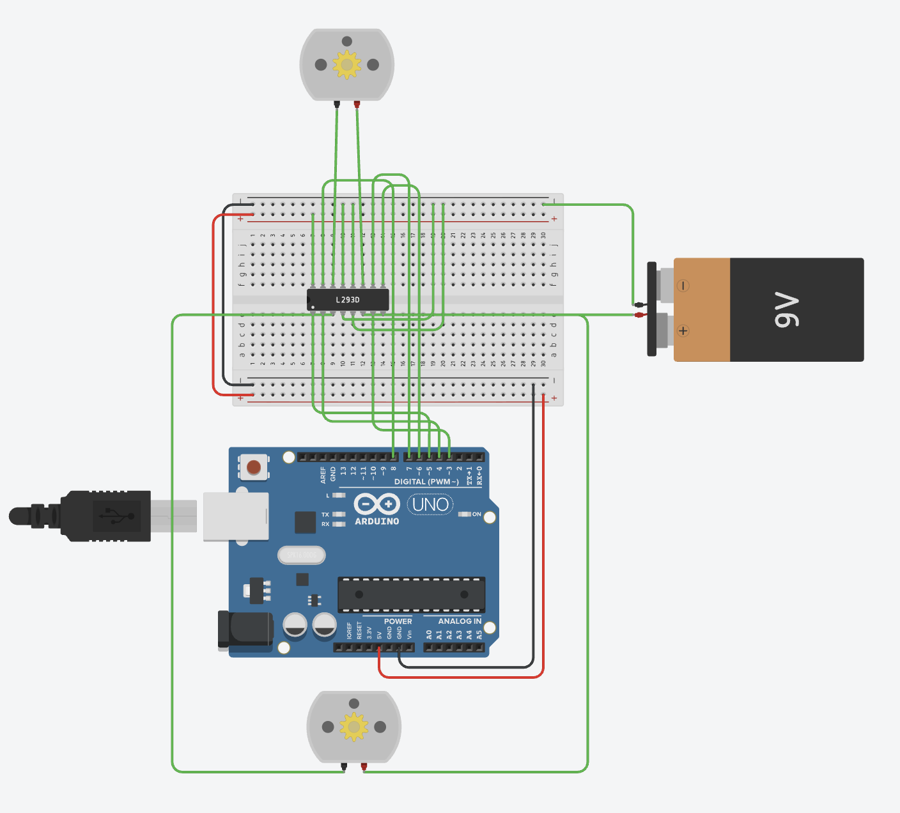

# Circuit Wiring and Power Supply

This page documents the **two-DC demo prototype**: Arduino Uno R3, L293D,
two DC motors, Processing, a camera and Wekinator. It does not describe the
separate stepper-motor or servo variants.

## Supplied circuit diagram

The team supplied this simulator diagram to document the circuit. It is a
wiring illustration, not a photograph of the assembled machine.

### Power-source placeholder

The simulator's **9 V battery is a placeholder only**. The actual prototype
uses the **school-provided power bank and power board**, for which equivalent
components were unavailable in the simulator. Do not interpret the battery
label as the actual motor-supply voltage or as an instruction to use 9 V.

The diagram does not establish loaded electrical performance or demonstrate
that the supply is sufficient under every operating condition.

## Motor-control connections

The following mapping matches the current `arduino/TwoDC/TwoDC.ino`.
Package-pin numbers refer to the 16-pin L293D, not Arduino pin numbers.

| Arduino Uno pin | L293D package pin | L293D function | Purpose |
|---|---|---|---|
| D5 | 1 | 1,2EN | Motor 1 PWM enable |
| D4 | 2 | 1A / IN1 | Motor 1 direction input A |
| D3 | 7 | 2A / IN2 | Motor 1 direction input B |
| D6 | 9 | 3,4EN | Motor 2 PWM enable |
| D7 | 10 | 3A / IN3 | Motor 2 direction input A |
| D8 | 15 | 4A / IN4 | Motor 2 direction input B |

| L293D package pins | Connection |
|---|---|
| 3 and 6 (1Y and 2Y) | Motor 1 terminals |
| 11 and 14 (3Y and 4Y) | Motor 2 terminals |
| 16 (VCC1) | 5 V logic supply from the Uno |
| 8 (VCC2) | Motor-supply positive, represented by the simulator battery |
| 4, 5, 12 and 13 | Common ground with Uno GND and motor-supply negative |

Motor 1 is the physical left motor in the current firmware. Both motors use
PWM 255. The direction logic in the supplied final code is LOW/HIGH for both
motors; terminal polarity and the actual mechanism determine the resulting
physical direction.

## Power distribution

- The Uno communicates with the computer over USB.
- L293D VCC1 supplies the driver's internal logic; VCC2 supplies its motor
  output stages. They are distinct supply connections.
- The physical motor-power path uses the school-provided power bank and power
  board in place of the simulated battery.
- Uno GND, L293D ground pins and motor-supply negative share a common reference.
- The final firmware notes that the yellow power-board bridge is removed.
  The bridge's location and function should be identified in a physical
  photograph before this instruction is used to reproduce the hardware.

Do not copy the simulator battery's voltage into the physical specification.
Verify the motor rating, actual supply voltage, driver limits and power
connections before energising the circuit. Disconnect power before rewiring.
Software stop and the heartbeat timeout do not replace an accessible physical
power-disconnection method.

## Documentation and verification status

| Item | Available evidence | Remaining work |
|---|---|---|
| Controller and driver | Supplied diagram and final code identify Uno R3 and L293D | Confirm with a labelled assembly photograph |
| Control-pin mapping | Current code and supplied diagram | Inspect actual jumper connections |
| Power-source type | Team reports a school-provided power bank and power board | Add a photograph of the actual distribution wiring |
| Circuit illustration | Simulator diagram included above | Add a physical wiring photograph |
| Motors | Two DC motors shown and controlled in firmware | Add a photograph of the installed motors |
| Demonstration | Behaviour specified by the code | Add a demonstration video and repeatable test results |

Supply ratings, motor specifications and test outcomes are recorded only when
supported by the team's evidence.

## Reference

- [Texas Instruments L293/L293D datasheet](https://www.ti.com/lit/ds/symlink/l293.pdf):
  package-pin functions and the separate logic and motor supplies.
